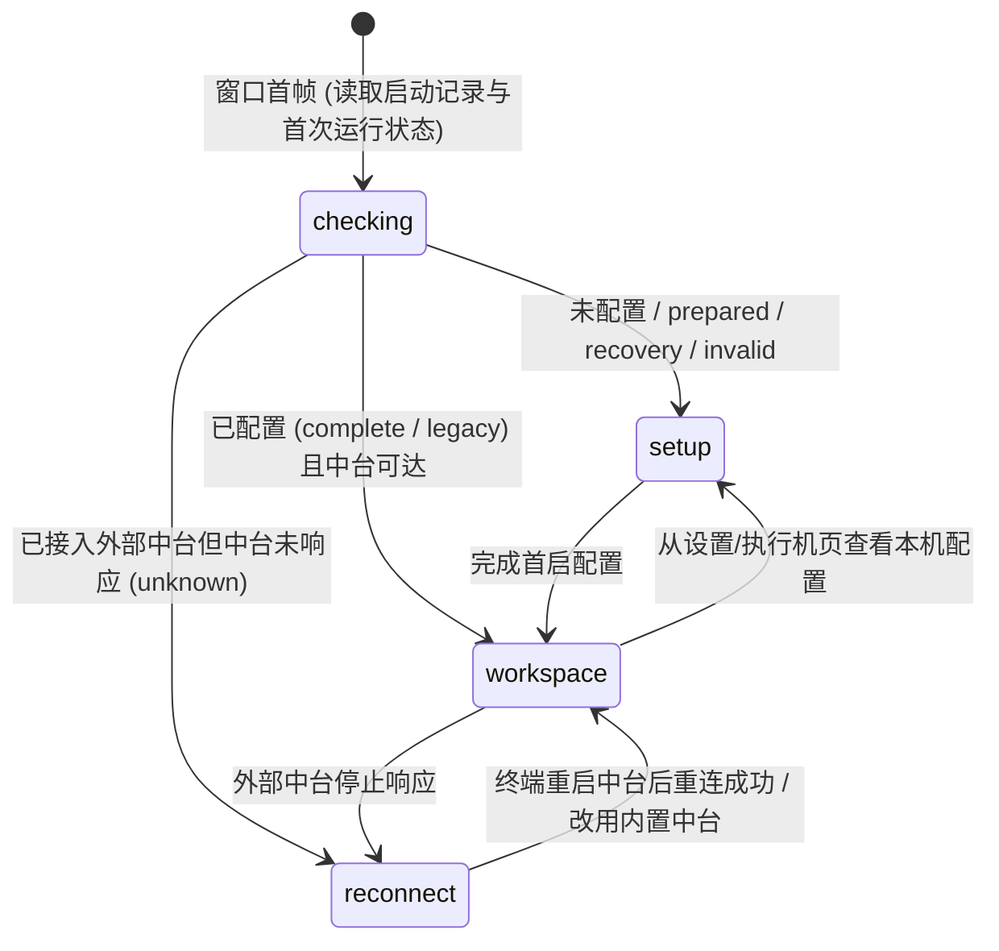

# 桌面端 UI 交互设计与前端开发规范

> 面向 `agent-autoloop` 桌面客户端（[desktop/](../desktop/)）的设计基准、交互架构、视觉令牌与开发约束。本规范与 [通信协议](protocol.md) 及 [桌面开发说明](desktop.md) 互为补充：协议定义业务事实，桌面开发说明定义进程与数据边界，**本文定义界面如何诚实、克制、优雅地呈现这些事实**。

---

## 一、 核心设计哲学（Four Pillars）

`agent-autoloop` 不是一个喧闹的聊天窗口，也不是一个堆满监控图表的运维大盘。它是一个**安静、确定、可信赖的指挥部（Command Center）**。桌面端的每一处交互都必须遵循以下四条第一性原理：

### 1. 注意力最贵：默认安静，只把需要人的事带回来

- **克制打扰**：没有待决策卡片或异常时，界面保持平静，不放闪烁动画、不放无意义的脉冲呼吸灯、不主动弹横幅抢夺视线。
- **决策优先**：在「今天」页，需要本人拍板的提问卡片（`ask`）永远排在最上方，采用高辨识度但克制的琥珀色左边框；已经不需要人介入的历史和通知退居「任务」页。
- **隐藏常态噪音**：常规操作（如自动化页的「刷新」按钮）在正常状态下隐藏，只在发生冲突或读取失败、确实需要人工恢复时才浮现。

### 2. 界面只说真话：不承诺不存在的能力，不伪造乐观状态

- **菜单是一句承诺**：「左侧导航栏可见」等价于「这台电脑已配置好工作空间，且菜单里的页面都能打开」。未完成首启配置（`setup`）、正在核查启动记录（`checking`）或接入的终端中台失联（`reconnect`）时，**隐藏整个侧边栏**，绝不渲染一排灰掉的禁用菜单去暗示尚未存在的功能。
- **未知就是未知，缺省不是零**：用量未上报时显示 `—` 并注明未上报轮数，不伪造成 `$0`；今天页费用固定单行，数字最多 8 位（不计小数点、货币符号和单位），超长大金额用万／亿缩写，超长小数仅在展示时舍入，极小金额用科学计数法避免显示成零。悬停显示完整已上报金额（USD），不改变原始费用及汇总计算；进程持有量无法读取时显示 `未确认`，绝不展示 `0`。
- **不做乐观更新（No Optimistic UI）**：中台的每一次写入都经过 SQLite 事务落盘。点击「回答」「结案」「停止」「更正」后，界面只展示真实的提交飞行状态与中台回执：
  - 点击「停止」后，轮次先显示 `正在停止`，等待执行机确认整个进程组退出后才变为已取消。
  - 提交「更正」不会篡改原轮次历史，而是保留原轮次结局、开启下一轮并入队列。
  - 网络超时或结果不明（`mustReread`）时，**严禁自动重发**，界面锁定写入入口并提供「重新读取此执行」按钮，先核实真相再做决定。
- **不渲染越权入口**：纯执行机（`worker`）没有 `owner` 密钥，设计上无法读取中台全局历史。因此纯执行机不渲染「今天」「自动化」导航，不渲染「＋ 派发任务」按钮，其「本机任务」页直接展示本机进程自报的持有量，而不是画一个永远加载不出来的空列表。同样地，当桌面端接入终端运行的外部中台（`ownership === "external"`）时，直接隐藏「启动／停止运行服务」按钮，而不是把它们置灰。

### 3. 一轮不等人，一窗一焦点：单屏沉浸，拒绝弹窗套娃

- **去模态化（Subpage over Modal）**：除系统级退出确认外，工作空间内的高密度任务（如「派发任务」「编辑自动化入口」）一律采用**原位子页面（In-page Subpage）**，与主页面共享 `<main>` 容器，通过 `← 返回` 胶囊按钮切换，不用模态弹窗遮挡上下文或制造焦点陷阱。
- **草稿跨页存活**：所有页面级控制器（`today`、`tasks`、`rules`、`settings`、`taskControl`）均为应用级单例（App-level Singletons）。用户在「派发任务」或「自动化编辑」写了一半切去看一眼「任务」历史，切回来时草稿分毫不差。
- **单写窗口与版本锁（CAS）**：自动化规则与设置项编辑均绑定读取时的配置版本（`rulesSeq`）。若后台配置已被终端或其他入口修改，保存会触发 `409` 冲突屏障——界面保留用户辛苦填写的草稿，高亮展示错误，并引导重新读取核对，绝不静默覆盖。

### 4. 工具级审美：高密度、瑞士网格、原生呼吸感

- **排版即结构**：对标 Linear、Raycast 与 macOS 原生开发者工具。依靠精确的字重对比、字号层级、1px 实线/虚线边框与留白建立秩序，拒绝厚重的投影（Drop Shadows）、毛玻璃噱头或花哨渐变。
- **无铬窗口（Chromeless Shell）**：顶部 44px 标题栏仅作为原生窗口拖拽区（`-webkit-app-region: drag`），不放任何标题文字、图标或冗余按钮；整个应用只通过页面内容自己说话。

---

## 二、 信息架构与导航规范（IA & Shell Architecture）

### 1. 窗口壳模式（Shell Modes）

根节点 `<html data-shell="...">` 严格控制整个窗口的骨架形态，由纯函数 `projectShell()`（见 [shell-mode.ts](../desktop/src/renderer/shell-mode.ts)）推导：



| `data-shell` 取值 | 侧边栏 `.sidebar`      | `<main>` 布局形态                  | 适用场景与交互约束                                                                                        |
| :---------------- | :--------------------- | :--------------------------------- | :-------------------------------------------------------------------------------------------------------- |
| `checking`        | 隐藏 (`display: none`) | 空白首帧                           | 启动记录与运行状态尚未返回前的诚实首帧，防止闪现错误菜单或闪现重连页。                                    |
| `setup`           | 隐藏 (`display: none`) | 双栏居中向导 (`max-width: 1040px`) | 首次运行配置、崩溃恢复（`prepared`）或从设置页查看配置。左栏粘性说明（300px），右栏表单卡片（`1fr`）。    |
| `reconnect`       | 隐藏 (`display: none`) | 双栏居中面板 (`max-width: 1040px`) | 接入的 CLI 中台失联。提供可一键复制的终端启动命令、重连探测按钮、本次会话改用内置中台按钮及退出应用入口。 |
| `workspace`       | 显示 (`width: 184px`)  | 单栏流式工作区 (`flex: 1`)         | 正常业务工作空间。左侧固定导航与状态，右侧独立纵向滚动（或子页面全高伸缩）。                              |

### 2. 双角色导航矩阵（Role-Based Navigation）

导航项由本机角色纯函数 `pagesFor(role)`（见 [navigation.ts](../desktop/src/renderer/navigation.ts)）决定，DOM 仅在角色签名变化时重建：

| 页面 ID      | `hub-worker`（中台＋执行机）     | `worker`（纯执行机）           | 页面核心职责                                                                                  |
| :----------- | :------------------------------- | :----------------------------- | :-------------------------------------------------------------------------------------------- |
| `today`      | **今天**（默认首页）             | _不提供_                       | 4 项今日核心指标、待你决策卡片（`ask`）、正在推进的活跃队列。                                 |
| `tasks`      | **任务**（全局执行记录）         | **本机任务**（本机持有量摘要） | 中台角色查全局历史、进入详情子页、回答/结案/停止/更正/反馈；纯执行机看本机自报持有量。            |
| `automation` | **规则**（本机规则与入口）     | _不提供_                       | 管理 `local` 事件入口与定时入口，提供原位草稿对比（新增/修改/删除）与 CAS 条件保存。          |
| `workers`    | **执行机**                       | **本机环境**                   | 本机运行服务启停与角色事实、本机持有量（中台角色）、已知执行机与通道心跳分布。                |
| `settings`   | **设置**（5 个分组）             | **连接与设置**（3 个分组）     | 编辑 Agent、来源（仅中台）、通知通道（仅中台）、查看角色连接、切换外观主题与全局时区/确认项。 |
| _全局动作_   | 侧栏及今天页 **「＋ 派发任务」** | _隐藏_                         | 进入 `dispatch-task` 子页面，选择真实事件入口并编写 Markdown 任务详情。                       |

---

## 三、 视觉设计系统（Visual Design System）

### 1. 色彩令牌（Color Tokens）

桌面端原生支持 **浅色（Light）**、**深色（Dark）** 与 **跟随系统（System）**，所有颜色通过 CSS 自定义属性定义在 `:root` 与 `:root[data-theme="dark"]`（见 [style.css](../desktop/src/renderer/style.css#L1-L38)）。**严禁在组件样式中硬编码任何十六进制或 RGB 颜色值**。

#### 表面与背景（Surfaces）

| 令牌          | 浅色模式 (Light) | 深色模式 (Dark) | 用途说明                                               |
| :------------ | :--------------- | :-------------- | :----------------------------------------------------- |
| `--bg`        | `#f4f6fa`        | `#0b0e14`       | 窗口底层画布背景（`<main>` 背景）                      |
| `--sidebar`   | `#edf1f7`        | `#0d1118`       | 左侧导航栏专属背景                                     |
| `--panel`     | `#ffffff`        | `#11151d`       | 一级卡片、面板、列表行、编辑器主背景                   |
| `--panel2`    | `#eef2f8`        | `#151a24`       | 二级内嵌容器、输入框、按钮常态、代码块、表头工具栏背景 |
| `--accent-bg` | `#e2ecff`        | `#18263e`       | 导航选中态、主按钮背景、悬停高亮、信息横幅背景         |

#### 文本与边框（Typography & Borders）

| 令牌       | 浅色模式 (Light) | 深色模式 (Dark) | 用途说明                                            |
| :--------- | :--------------- | :-------------- | :-------------------------------------------------- |
| `--text`   | `#1b2639`        | `#e7eaf2`       | 主文本、标题、表单输入文字（高对比度冷色调）        |
| `--muted`  | `#526079`        | `#a0a9bc`       | 次要说明、字段标签、时间戳、未选中导航、辅助图标    |
| `--faint`  | `#596780`        | `#8994aa`       | 弱化提示、眉题（Eyebrow）、空状态图标、离线状态文字 |
| `--border` | `#cad3e2`        | `#283143`       | 卡片外框、输入框边框、列表分割线、按钮边框          |
| `--soft`   | `#dfe5ef`        | `#1c2432`       | 极弱分割线（如标题栏底边、侧栏右边、卡片内部分割）  |

#### 语义与状态色（Semantics）

| 令牌       | 浅色模式 (Light) | 深色模式 (Dark) | 语义与使用场景                                                       |
| :--------- | :--------------- | :-------------- | :------------------------------------------------------------------- |
| `--blue`   | `#255bb7`        | `#78a7ff`       | 焦点外框（`:focus-visible`）、运行中状态、主操作边框、向导当前步     |
| `--accent` | `#2869d7`        | `#4c8dff`       | 品牌点缀、链接文字、引用块左边框、选中激活态边框                     |
| `--green`  | `#197543`        | `#6cdaa0`       | 在线圆点、在线徽章、草稿「新增」徽章、派发成功状态左边框             |
| `--amber`  | `#865309`        | `#f5be6c`       | 待决策卡片（`! 待决策`）左边框与徽章、草稿「修改」徽章、侧栏异常圆点 |
| `--red`    | `#b3342c`        | `#ff8b84`       | 失联（`unknown`）徽章、草稿「删除」徽章、阻塞级错误提示左边框        |

> [!TIP]
> **半透明语义背景规范**：当需要为语义徽章或高亮卡片生成柔和底色时，统一使用原生 `color-mix(in srgb, var(--semantic-color) 8%, transparent)`（或与 `var(--panel)` 混合 4%~6%），保证深浅色主题下均具备高级的通透感，无需额外定义几十个衍生色变量。

### 2. 字体与排版尺度（Typography Scale）

- **无衬线字体栈（UI 正文）**：`-apple-system, BlinkMacSystemFont, "PingFang SC", "Microsoft YaHei", sans-serif`
- **等宽字体栈（代码、ID、指标、命令）**：`--mono: ui-monospace, "SF Mono", Menlo, Consolas, monospace`
- **全局抗锯齿**：`-webkit-font-smoothing: antialiased`，默认基准字号 `13px`，行高 `1.6`。
- **行宽控制（Measure）**：长段落说明文字（如首启向导、重连说明、空状态正文）限制在 `440px` 或 `56ch` 以内，防止宽屏下视线换行迷失；表单控件与列表行则随容器自适应拉伸。

| 层级名称                       | 字号 (`font-size`)     | 字重 (`font-weight`) | 行高 (`line-height`) | 典型应用场景                                                                       |
| :----------------------------- | :--------------------- | :------------------- | :------------------- | :--------------------------------------------------------------------------------- |
| **大号数据指标**               | `27px` (`var(--mono)`) | `600`                | `1.4`                | 今天页顶部 4 项统计卡数值（`.today-stat-value`）                                   |
| **一级页面标题 (`h1`)**        | `24px` (子页 `18px`)   | `700` (默认)         | `1.4` (子页 `1.3`)   | 页面顶栏主标题 `#page-title`                                                       |
| **面板/分组标题 (`h2`)**       | `15px`                 | `650`                | `1.6`                | `.panel h2`、今天页分段标题、向导问题标题                                          |
| **列表项主标题 (`h3`/强文本)** | `13px`                 | `550` ~ `600`        | `1.5` ~ `1.6`        | 决策卡片标题、任务规则名、自动化入口名、执行机名                                   |
| **编辑器正文**                 | `14px`                 | `400`                | `1.5`                | 派发任务所见即所得 Markdown 正文输入与预览                                         |
| **标准界面正文**               | `13px`                 | `400`                | `1.6`                | 按钮、输入框、表单标签、一般描述文本                                               |
| **辅助说明 / 元数据**          | `11px` ~ `12px`        | `400`                | `1.5` ~ `1.6`        | 页面副标题、列表行次要信息（`.entry-meta`、`.run-meta`）、表单提示                 |
| **微型徽章 / 眉题**            | `10px`                 | `600`                | `1.4`                | 状态胶囊（`.badge`、`.today-card-kind`）、全大写眉题（`.eyebrow`，字间距 `1.6px`） |

### 3. 空间、圆角与栅格（Spacing, Radius & Layout）

- **窗口设计尺寸**：基准视口为 **1080 × 760**，支持缩窄自适应。`<main>` 开启 `scrollbar-gutter: stable`，避免展开详情或加载列表出现滚动条时引起页面横向抖动。
- **内边距规范**：
  - 主工作区 `<main>`：`padding: 24px 28px 30px`（`≤850px` 时收紧为 `22px`；全高子页面 `#task-subpage` 收紧为 `14px 20px 16px` 以最大化编辑器视口）。
  - 独立面板 `.panel`：`padding: 20px`，底部间距 `margin-bottom: 16px`。
  - 列表行（`.today-run-row` / `.entry-item`）：`padding: 13px 15px` ~ `14px 15px`。
- **圆角阶梯（Border Radius）**：
  - `999px`（胶囊形）：返回按钮（`.task-back-button`）、设置页顶部分组标签（`.settings-tab`）、事件类型代码标签（`.entry-types code`）、任务状态胶囊（`.run-state`）。
  - `9px` ~ `10px`：一级面板（`.panel`）、空状态虚线框（`.empty`）、模态框。
  - `8px`：统计卡（`.today-stat`）、分体式列表首尾圆角、编辑器外框（`.task-editor-box`）。
  - `6px`：所有标准按钮（`button`）、下拉框（`select`）、文本输入框（`input` / `textarea`）、错误/状态提示条。
  - `4px`：微型状态标签（`.run-badge`、`.entry-badge`、`.today-card-kind`）、行内代码。
- **响应式断点**：
  - `@media (max-width: 900px)`：首启向导与重连页从左右双栏（`300px + 1fr`）堆叠为单栏垂直居中（`justify-content: safe center`）。
  - `@media (max-width: 850px)`：今天页 4 列指标卡（`repeat(4, 1fr)`）变为 2×2 网格（`repeat(2, 1fr)`），侧边栏宽度从 `184px` 收缩至 `164px`。
  - `@media (max-width: 650px)`：首启角色选择双卡片变为单列堆叠。

---

## 四、 核心组件与交互模式库（Component & Pattern Library）

### 1. 连体式列表行（Joined List Rows）与原位草稿态

在「今天」页的运行列表、「自动化」页的入口列表以及「设置」页的配置列表中，多行条目不使用松散的独立卡片，而是采用**共享边框的连体式列表**：

- **常态结构**：每行 `border: 1px solid var(--border); border-bottom: 0; background: var(--panel)`，仅首行左上/右上 `8px` 圆角、末行补齐 `border-bottom` 与左下/右下 `8px` 圆角（单行时四角 `8px`）。
- **原位草稿对比（In-place Diff）**：在「自动化」页修改、新增或删除入口后，草稿条目直接混排在同一列表中，用视觉语言交代变更种类：
  - **未保存虚线框**：所有发生变更的行（`.added` / `.changed` / `.removed`）边框变为 `border-style: dashed`。
  - **语义徽章**：标题前插入微型徽章——绿色 `新增`、琥珀色 `修改`、红色 `删除`。
  - **墓碑行（Tombstone Row）**：被删除的原有入口不会从列表里凭空消失，而是保留在原插槽位置，标题加上删除线（`text-decoration: line-through; color: var(--muted)`），右侧操作变为「撤销删除」。这样用户能清楚核对每一个插槽的增删改，底部 `.draft-bar` 实时汇总「本次保存将提交 X 条本机入口：新增 A 条、修改 B 条、删除 C 条」。

### 2. 单栏标题路由条 + 所见即所得 Markdown 编辑器

在「派发任务」（`#task-subpage`）中，为避免传统表单的冗长割裂感，采用紧凑的 IDE 级布局：

- **派发完成即返回来源页**：只有明确接受的回执才自动返回打开派发页时的实际来源页，并先清空已提交正文、标题和草稿，再解除单飞操作记录。失败或结果不明不返回、不重发、不清空内容；关闭与导航保存草稿不能恢复已经提交的内容。
- **两层融合顶栏（`.task-title-route-bar`）**：上层为占满宽度的无边框大字号任务标题输入（`15px, font-weight: 600`），下层为轻量规则条（`background: var(--panel2)`），包含「规则」选择器与「由 `<agent>` 执行」状态摘要；事件类型采用渐进披露——仅 1 个固定类型时隐藏下拉框直接并入摘要，多类型或含 `*` 通配符时才展开「事件类型」选择或具体类型输入框。整条顶栏共享 `:focus-within` 蓝色高亮外框。
- **单栏行级 WYSIWYG 编辑器（`.task-wysiwyg-box`）**：
  - 顶部工具栏提供标题、粗体、代码、引用、列表、待办快捷按钮。
  - 画布区域分为三明治结构：光标所在行（或代码块）上方为已渲染的 `.markdown-body` 切片（`beforeWrap`），当前激活行为自适应高度的无缝 `<textarea class="task-wysiwyg-active-input">`（根据 `#`、`>`、` ``` ` 动态赋予 `data-block-type` 实时改变字号和缩进），下方为后续已渲染切片（`afterWrap`）与底部点击留白区（`tail`）。
  - **焦点稳定性铁律**：切换激活行时，绝对不能把正在聚焦的 `activeEditor` 从 DOM 树移除再重新挂载（Chromium 中卸载聚焦节点会同步触发 `blur` 事件打断编辑流），必须保持 `beforeWrap`、`activeEditor`、`afterWrap` 三个节点常驻，仅替换前后切片的子节点。
  - 勾选已渲染切片中的任务复选框（`- [ ]`）时，直接同步更新底层隐藏 `<textarea id="task-detail">` 并持久化草稿。

### 3. 任务原位详情子页与分段游标分页（In-page Detail & Segmented Paging）

在「任务」页查看执行历史时：

- 点击执行记录（`.run-head`）进入与列表共享 `<main>` 的详情子页（`.tasks-detail-page`），不在列表行下展开、不弹模态窗。子页有「← 返回」与「执行详情」标题；列表节点保留挂载但隐藏，返回保留服务端查询条件、已加载分页与滚动位置，键盘焦点回到原记录。切换其它导航页不销毁详情中的表单草稿。
- **子页外观与派发页统一**：详情打开时移除列表的整页面板外框，使用透明、无边框的工作区；主区域间距为 `14px 20px 16px`，返回按钮与 `18px` 标题同排，标题行下方间距为 `10px`。相关轮次与操作表单仍保留内容分区边框，返回列表时恢复列表面板样式。
- **真实记录按轮次组织**：当前轮次展示结果摘要、失败原因、起止时间、真实事件正文、卡片和回答；关联轮次先显示各自摘要，再按需进入该轮详情。摘要是中台轮次记录，不伪装成 Agent 聊天消息。现有接口不读取完整 Agent 对话、工具调用或执行机 stdout/stderr，必须明确提示「完整执行消息未记录到中台，当前接口无法读取」，不可用模拟消息补齐。文本按安全纯文字呈现，截断如实注明。
- **四段独立懒加载**：详情内的「触发事件」「相关卡片」「关联执行记录」与「已提交反馈」各自维护独立的状态机（`idle` / `loading` / `end` / `capped` / `failed`）与游标按钮，防止单次执行关联成百上千条事件时撑爆首屏内存。分页和反馈通知仅更新展示区，不移除正在输入的表单节点。
- **两步确认防误触（Two-Step Arming）**：在运行详情中点击「停止执行」时，不弹原生阻塞框，按钮文案原位变为「确认停止」并浮现说明「停止只结束所选这一轮；时间线与成本记录保留」，第二次点击才真正发出请求。写入飞行时禁止重复提交并禁用返回；结果不明只提供重读，不自动重发。

### 4. 空状态与异常反馈（Empty & Error States）

- **空状态（`.empty` / `.today-empty`）**：采用 `1px dashed var(--border)` 虚线框与 `--panel` 背景，居中排版。文案必须交代两件事：**现在为什么是空的** + **什么时候会有内容（或提供直接行动按钮，如「＋ 添加入口」）**。例如：「没有待决策事项 —— 需要你介入时，决策会集中出现在这里。」
- **分立的状态行与错误条**：
  - 常规进展与数据时间戳使用 `<p role="status" aria-live="polite">`，文字颜色为 `--muted` 或 `--faint`。
  - 拒绝、冲突或异常使用带左侧 `3px` 实线色条（`--blue` 或 `--red`）的提示框（`.setup-error` / `.today-error`），设置 `role="alert"`。当向导或表单报错重绘时，自动将键盘焦点移至 `.setup-error`，确保屏幕阅读器与键盘用户第一时间感知。

---

## 五、 页面级交互细则（Page-by-Page Walkthrough）

1. **首启与配置页（`setup-view.ts`）**：
   - 仅 2 步：`1. 选择角色` → `2. 连接`。
   - 选「中台＋执行机」进入第 2 步时自动触发 `setupConnect()` 只读探测：若 CLI 已配中台且在线，直接显示已连接并放开「完成」；若未配置，静默准备并启动内置中台；若探测失败，提供「重试」与改用内置中台的清晰指引。
   - 选「纯执行机」进入第 2 步时展示 3 个必填项（中台地址、本机名称、加入密钥）。点击「连接」先在主进程完成协议与身份握手验证，验证通过才落盘并锁定角色；验证失败（连接失败、密钥被拒、身份不符）则保留地址与名称草稿供原位修改重试。**密码框在每次跨桥交接、返回或离开时立即清空（`finally` 块兜底），绝不驻留 DOM 或控制器草稿**。
2. **今天页（`today-view.ts`）**：
   - 顶部 4 张指标卡：`待你决策`、`正在推进`、`今日完成`、`今日费用`。
   - 下方仅展示「待你决策」开放卡片与「正在推进」活跃轮次，提供跳转到「任务」列表的轻量文字链（`.today-task-link`）。
3. **任务页（`tasks-view.ts` / `local-summary-view.ts`）**：
   - `hub-worker` 角色：顶部为服务端搜索框（防抖输入，明确标注「关键词只匹配任务摘要与失败原因，查询覆盖本机中台的全部执行记录」）与状态筛选下拉框。列表按 `id` 降序游标分页，追加时按 `id` 去重。进入原位详情子页（返回保留列表条件、分页和位置）可执行：停止、提交更正、回答提问卡片（选项按钮或自由文本）、结案通知卡片、对已完成轮次记录三选一交付反馈（「交付满意 / 需要改善 / 内容错误」）。
   - `worker` 角色：渲染 `.local-summary-scope` 说明面板 + `local-reading-view` 本机持有量面板。
4. **规则页（`rules-cas-view.ts`）**：
   - 列表页展示所有 `local` 事件规则与定时规则；点击「编辑」或「＋ 添加规则」经 `automation-entry` 伪页面切换至子页面（页面头换为「← 返回 + 编辑规则／添加规则」的子页面形态，与派发任务页同构）。
   - 子页面表单按事实分组：**融合顶栏**（规则名称 + 触发方式下拉，`:focus-within` 蓝框一体）→ **触发分组**（事件类型 / 时间表 cron，二者按触发方式显隐，隐藏字段的值保留在内存中，提交时只读取当前可见触发方式的字段）→ **执行分组**（执行体下拉、工作目录、并行数）→ **高级折叠**（原生 `<details>`，收起提示词、技能、分组、收尾通知、输出事件等可选字段，摘要行以「已填 N 项」胶囊如实交代折叠内容，全空时安静隐藏）。
   - 编辑器表单控件**一次挂载**，`update()` 只改 `hidden`/`textContent`/`disabled`，后台通知不会打断正在输入的焦点；打开时焦点落在规则名称输入框。
5. **执行机页（`run-view.ts` + `local-reading-view.ts` + `workers-view.ts`）**：
   - 自上而下由三块面板拼成：① 本机运行服务卡片（状态徽章、本机角色/自动启动/离线待同步 3 项 `<dl>` 事实、上次启停历史回执、启停按钮）；② 本机持有量卡片（仅 `hub-worker` 在此展示，含已接单/准备中/执行中/停止中/待同步/未确认 6 项计数）；③ 中台已知的执行机分组（本机置顶，按名称稳定排序，展示在线状态、最后心跳与各 Agent 任务分布）与通知通道状态。
6. **设置页（`settings-view.ts`）**：
   - 顶部为横向胶囊标签栏（`.settings-tabs`）：`Agent`、`来源`、`通知通道`、`角色连接`、`通用`。
   - Agent 新增与编辑使用**原位子页面**，隐藏列表与分组栏，提供「← 返回」及「添加 Agent／编辑 Agent」标题。子页移除整页外框，使用透明工作区，主区域间距为 `14px 20px 16px`；返回与 `18px` 标题同排，间隔 `8px 12px`，标题行下方间距 `10px`，正文不再叠加设置列表的顶部间距。返回列表恢复原面板外框，不改变设置列表标题。
   - Agent 字段按**基本信息**（标识、名称）与**运行配置**（执行机标识、用法、权限、模型、推理强度、命令、超时秒数）分组；仅内容分区保留边框。后台通知不重建表单或移除正在聚焦的输入节点，导航切换保留输入。返回取消未提交编辑并回到 Agent 分组；保存冲突或结果不明保留子页草稿，禁止重复保存与返回，只能通过重新读取解除屏障。
   - 来源、通知通道与通用设置沿用原有编辑形态，不随 Agent 子页重构。保存仍将当前修改行与其余草稿行合成为完整分段（Whole-section replacement），绑定草稿起始配置版本一次性提交，避免局部补丁造成状态撕裂。

---

## 六、 前端开发与工程规范（Frontend Engineering Standards）

后续开发或修改 `desktop/` 界面时，必须严格遵守以下工程铁律。这些规则同时由 `desktop/tests/` 中的单元测试与安全回归测试守护：

### 1. 零第三方 UI 依赖与安全沙箱（Zero UI Dependencies & Strict CSP）

- **纯原生技术栈**：渲染进程只使用原生 TypeScript、HTML5 与现代 CSS（CSS Grid、Flexbox、Custom Properties、`color-mix`）。不引入 React、Vue、Tailwind 或任何第三方组件库。
- **严格的 Content-Security-Policy**：`index.html` 锁死 `default-src 'none'; script-src 'self'; style-src 'self'; img-src 'none'; font-src 'none'; connect-src 'none'`。
  - **禁止图片与外部字体**：由于 `img-src 'none'`，所有图标必须使用内联 `<svg>`（统一 `viewBox="0 0 24 24"`，`stroke="currentColor"`，`stroke-width="1.6"`）；下拉框箭头等装饰图形使用纯 CSS 边框旋转绘制（见 `select::after`）。
  - **禁止渲染进程直接发起网络请求或读写剪贴板**：`connect-src 'none'` 且权限处理器默认拒绝一切权限。所有与中台的通信、文件读取、剪贴板写入（如复制终端启动命令 `copyLaunchCommand`）必须通过 `preload.ts` 暴露的 `window.desktop` 命名通道，由主进程校验发送方（`assertSender`）后代为执行。

### 2. 防注入 DOM 构建铁律（Anti-XSS DOM Construction）

- **严禁将业务数据或用户输入拼入 `innerHTML`**：这是本仓库的最高安全红线之一（“卡片页面把别人写的字当成标记显示”直接判定为事故）。
- `innerHTML` 仅允许在 `app.ts` 初始化固定静态页面骨架或固定 SVG 路径时使用。
- 所有视图模块（`*-view.ts`）必须使用 `document.createElement` 构建节点，使用 `node.textContent = ...` 填入文字，使用 `node.replaceChildren(...)` 刷新列表。
- Markdown 预览必须且只能走内置的安全解析器 [markdown.ts](../desktop/src/renderer/markdown.ts)（内部完全通过 `createElement` 和 `textContent` 构造安全标签，链接仅放行 `http://`、`https://`、`mailto:`）。

### 3. 视图与控制器分离架构（Controller-View Separation）

每个业务模块拆分为成对的两个文件：`*-controller.ts` 与 `*-view.ts`：

- **Controller（纯状态机，无 DOM 依赖）**：
  - 只依赖传入的桥接接口（`window.desktop` 的子集）和 `onChange: () => void` 回调。
  - 负责维护单飞锁（Single-flight guard）、请求代数（Generation / Sequence token，丢弃过期的迟到回包）、草稿快照（`rulesSeq`）以及状态流转。
  - **必须可在纯 Node.js 环境下直接单测**，无需启动浏览器或 Electron。
- **View（纯 DOM 投影）**：
  - 暴露 `mount*View(root, controller, ...)`，返回 `{ root?, update(), dispose?() }`。
  - 静态表单控件在 `mount` 时一次性创建，后续 `update()` 只修改 `textContent`、`disabled`、`hidden` 和 `dataset`，**不在每次状态通知时销毁重建整个表单**，从而保护用户的输入焦点、光标位置与未提交内容。

### 4. 无障碍与系统高对比度兼容（Accessibility & Forced Colors）

- **语义化地标与实时播报**：主内容区 `<main tabindex="-1" aria-labelledby="page-title">` 在页面切换时承接焦点（首启自动揭幕时传 `focus = false` 避免抢焦点）；动态状态行标注 `role="status" aria-live="polite"`，错误框标注 `role="alert"`。
- **键盘导航与焦点可见性**：全局统一 `:focus-visible { outline: 2px solid var(--blue); outline-offset: 3px; }`。除无边框内嵌输入框（由父容器 `:focus-within` 接管外框）外，不得随意设置 `outline: none`。
- **高对比度模式（`@media (forced-colors: active)`）**：凡是靠背景色或边框色表达选中态/警示态的组件（如 `.sidebar nav button.active`、`.settings-tab.active`、`.setup-choice[aria-pressed="true"]`、`.today-decision`），必须在 `forced-colors: active` 媒体查询中显式补充 `outline: 2px solid Highlight` 或 `CanvasText` 边框，确保视障用户在系统高对比度模式下清晰辨识。

### 5. 文案与注释规范（Copywriting & Comments）

- **界面文案用中文大白话**：面向用户的标题、提示、报错一律使用平实的中文，直接说清“现在是什么状态、为什么失败、下一步点哪里”。不使用黑话（如“CAS 冲突”“RPC 失败”“Payload 非法”“Worker 进程”——界面上统一称“执行机”或“执行体”）。
- **代码注释用英文，只写代码看不出来的原因（Why, not What）**：解释状态机为什么这样守卫、为什么某个按钮是 `hidden` 而不是 `disabled`、为什么某个 DOM 节点不能卸载。

---

## 七、 新增或修改 UI 时的自检清单（UI Review Checklist）

在提交任何 `desktop/src/renderer/` 改动前，逐条核对：

- [ ] **诚实性检查**：是否展示了一个点击后必定被中台拒绝的按钮？纯执行机是否意外露出了全局管理入口？未上报的数据是否被错误显示成了 `0`？
- [ ] **单飞与结果不明检查**：写入按钮在飞行期间（`busy`）是否已禁用？当返回 `mustReread`（结果不明）时，是否阻止了直接重发并引导用户先重读？
- [ ] **DOM 安全与焦点检查**：是否100%使用 `createElement` + `textContent`？表单在收到后台状态推送触发 `update()` 时，正在输入的文本框是否会丢失焦点或被清空？
- [ ] **双主题与响应式检查**：在 Light / Dark / `forced-colors` 下对比度是否达标？窗口缩窄到 `850px` 和 `650px` 时是否有横向溢出？
- [ ] **自动化验证**：
  ```bash
  npm --prefix desktop run typecheck
  npm --prefix desktop test
  npm run format:check
  ```
